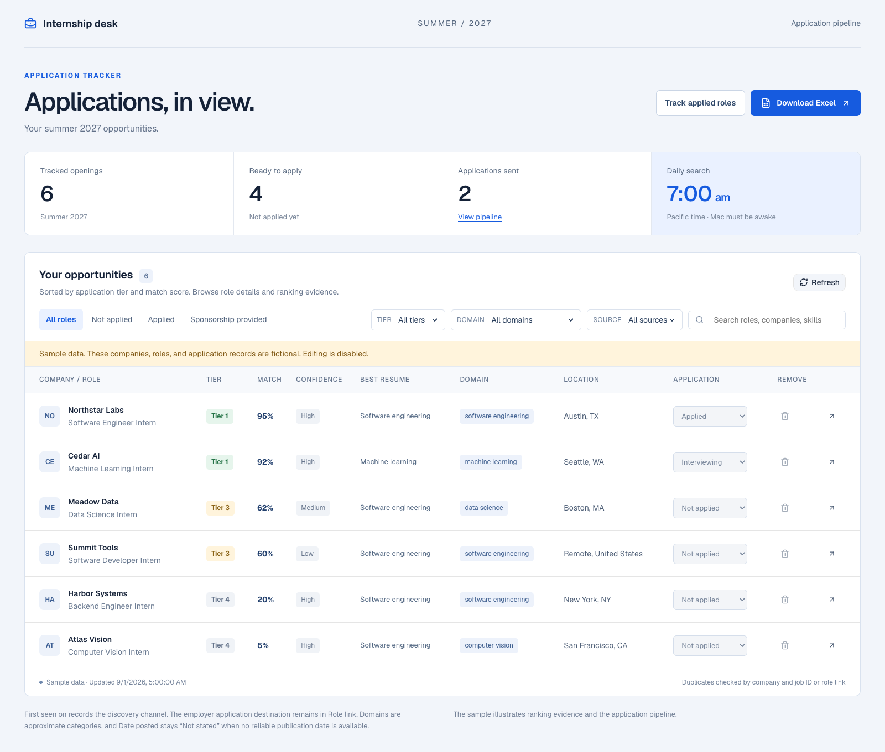
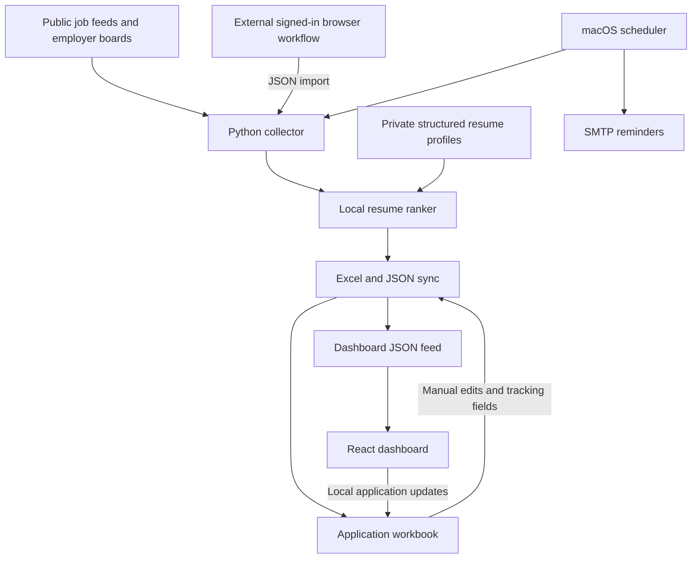

# Internship tracker

[](https://github.com/amoghskanda/internship-tracker/actions/workflows/ci.yml)

A personal internship search system that turns scattered job listings into a ranked application queue. It collects public postings, compares their requirements with local resume profiles, preserves application progress in Excel, and presents the results in a browser dashboard.

I built it to manage my Summer 2027 internship search. The daily workflow combines scheduled collection with listings gathered through my own signed-in browser sessions and subscription tools. This repository contains the collection adapters, ranking engine, workbook sync, scheduler, and dashboard. The private accounts and external browser workflows are not included.



[Ranking details](docs/images/ranking.png) · [Application pipeline](docs/images/pipeline.png)

## Try the dashboard

The dashboard runs with fictional sample data and needs no subscription, resume, database, or API key. You can filter openings, inspect ranking evidence, and browse the application pipeline. Sample records are read-only.

Requirements: Node.js 22.13 or newer and npm.

```sh
cd dashboard
npm ci
npm run dev
```

Open the local URL printed by the dev server. The sample loads automatically when no live feed is available. All sample employers, postings, and application records are fictional. The Excel download is a blank workbook schema.

## What it does

- Collects Summer 2027 internship listings from SimplifyJobs, Jobright, and configurable Greenhouse and Ashby boards. A JSON adapter accepts listings gathered through a separate browser workflow.
- Normalizes employer links and deduplicates postings while retaining the original discovery channel. Missing publication dates and sponsorship policies remain unknown.
- Ranks each role against multiple resume variants using local text matching. Each result includes a tier, confidence level, eligibility result, supporting skills, gaps, and tailoring suggestions.
- Merges updated source data into Excel without replacing application status, notes, contacts, dates, removal state, or manual priority overrides.
- Filters and sorts the queue by tier, score, domain, source, sponsorship, and application status. A separate page tracks assessments, interviews, and outcomes.
- Runs a daily collection and ranking workflow through macOS `launchd`, with configurable email reminders for pending roles.

## How the pieces connect



The collector and ranker use the Python standard library. The dashboard uses TypeScript, React, Vinext, Tailwind CSS, and Base UI. The scheduler stores run and reminder state in SQLite. Hosted application updates use Cloudflare D1; the local workflow writes to the workbook through a loopback HTTP service.

## Engineering choices

**Explainable ranking.** The score combines skill coverage, evidence in the resume profile, domain fit, task overlap, and title fit. Listing completeness controls confidence. A matching title alone cannot produce Tier 1. Known eligibility failures apply separately from match quality. These scores are prioritization heuristics, not predictions of an offer or a validated measure of hiring suitability.

**Application state survives refreshes.** The sync distinguishes source-owned fields from application-owned fields and merges by stable job identity. Removed roles stay removed after later collection runs. The writer checks for Excel locks and concurrent changes, makes a backup, and replaces the workbook atomically.

**Failures have explicit boundaries.** A failed ranking step blocks workbook sync. A failed email does not mark a reminder as sent. Retry timing and process locks prevent repeated work. The collector reports individual source failures alongside successful results.

**Private inputs stay local.** The ranker does not call a model API or send resume text over the network. The public dashboard uses only synthetic fixtures. Runtime data, profiles, credentials, and deployment settings are ignored by Git.

Read [the architecture](docs/architecture.md) and [ranking method](runner/docs/ranking-algorithm.md) for implementation details.

## Run the ranking engine offline

Python 3.10 or newer is enough. This command uses only the included fictional jobs and example profiles.

```sh
python3 runner/scheduler/ranker.py \
  --jobs examples/jobs.json \
  --resume-profile runner/examples/resume-profile.example.json \
  --output runner/data/demo-ranked.json
```

The generated JSON contains the ranking explanations and evidence fields shown in the dashboard. To collect current public listings, install the collector and run it separately:

```sh
python3 -m venv .venv
source .venv/bin/activate
python -m pip install -e ./collector
python -m internship_collector --output runner/data/collected.json
```

Public feeds can change, disappear, or omit requirements. Collection does not guarantee complete coverage or that a posting is still open.

## Running the full personal workflow

The dashboard and offline ranker work independently. Reproducing the full workflow requires additional configuration:

| Part | Requirement |
| --- | --- |
| Browser-sourced listings | Your own signed-in sessions or subscriptions, plus a separate workflow that exports JSON |
| Excel sync | Access to the `@oai/artifact-tool` spreadsheet runtime, which is not distributed in this repository |
| Personalized ranking | A local structured resume profile |
| Email reminders | Your SMTP account and recipient settings |
| Scheduled local service | macOS and a configured `launchd` agent |
| Hosted application edits | A Cloudflare D1 database and access protection for the deployment |

The hosted API has no built-in user authentication. Protect a deployment with an authentication layer before connecting personal application records. Making this source repository public does not make the personal tracker or its data public.

See [setup instructions](docs/setup.md) for the local service and [the Excel CLI](excel/README.md) for the runtime boundary.

## Code map

| Directory | Start here |
| --- | --- |
| `collector/` | [`collector.py`](collector/internship_collector/collector.py) coordinates adapters, enrichment, filtering, and deduplication |
| `runner/` | [`ranker.py`](runner/scheduler/ranker.py) scores resume variants; [`runner.py`](runner/scheduler/runner.py) coordinates scheduled work |
| `excel/` | [`sync.mjs`](excel/src/sync.mjs) handles workbook merges, backups, and application edits |
| `dashboard/` | [`tracker.ts`](dashboard/lib/tracker.ts) loads local, hosted, or sample data; [`components/`](dashboard/components) renders the table and ranking details |
| `examples/` | Fictional jobs for an offline ranking run |
| `docs/` | Architecture, setup, and dashboard screenshots |

## Checks

```sh
(cd collector && python3 -m unittest discover -s tests -v)
(cd runner && python3 -m unittest discover -s tests -v)
(cd dashboard && npm ci && npm run lint && npm run typecheck && npm test && npm run build)
```

The GitHub Actions workflow runs these checks without personal credentials. The Excel integration suite requires the separate spreadsheet runtime and runs with `cd excel && npm test` when that dependency is available.
